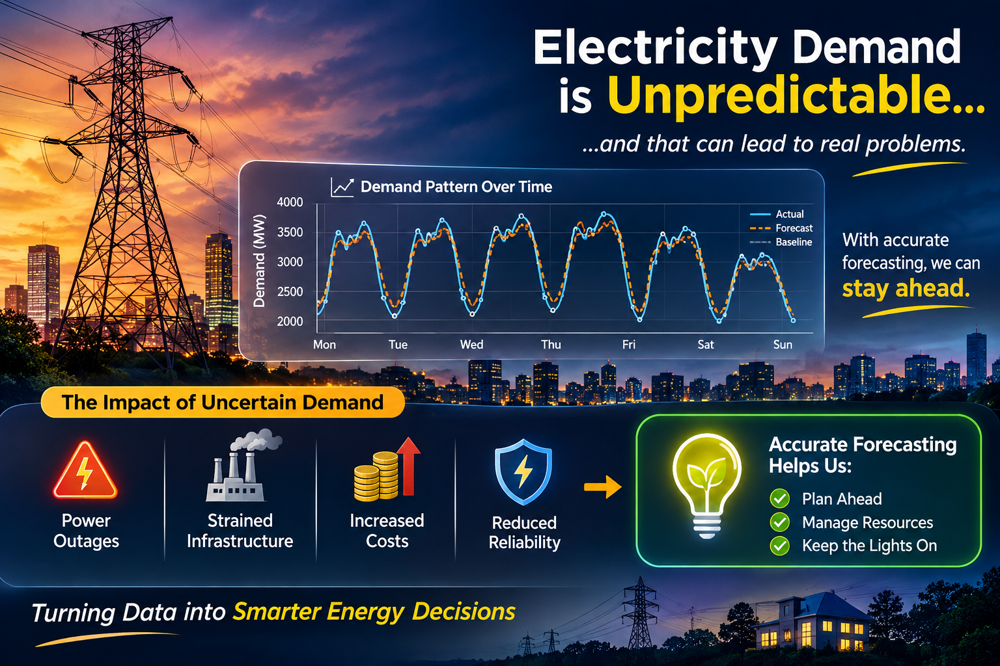

# ⚡ Hourly Electricity Demand Forecasting (24-Hour Horizon)
Built an hourly electricity-demand forecasting pipeline (44K records, 2020–2024) that predicts 24 hours ahead - cleaned timestamps and sensor spikes, engineered cyclical, lag, and degree-hour features, and cut MAE by 56% versus a seasonal-naive baseline on a held-out year, with SHAP explanations.




## 📖 Overview

This repository contains an end-to-end time-series machine learning pipeline designed to forecast hourly electricity demand **24 hours ahead**. 

Built on ~44,000 hourly records (2020–2024), the project demonstrates rigorous data cleaning, advanced feature engineering, and robust modeling using **LightGBM**. The pipeline is designed with production-readiness in mind: it rigorously prevents data leakage, uses time-series cross-validation, and exports model artifacts along with the exact metadata needed to rebuild features in a live serving environment.

**The model achieves a Mean Absolute Error (MAE) of ~102 MW and a MAPE of 2.16%, outperforming a seasonal-naïve baseline by over 56%.**

---

## 📊 Dataset & Assumptions

The dataset (`electricity demand dataset.csv`) contains ~44K hourly records with the following columns:
*   `Timestamp`, `hour`, `dayofweek`, `month`, `year`, `dayofyear` *(Calendar features)*
*   `Temperature` (°C)
*   `Humidity` (%)
*   `Demand` (MW) *(Target Variable)*

*Production Assumption:* The model is provided with the weather forecast for the hours being predicted. In a real-world scenario, you would feed the model the *weather forecast* rather than the actual future weather.

---

## 🛠️ Detailed Pipeline Architecture

The notebook follows a strict data science lifecycle to prevent data leakage and ensure robust performance.

### 1. Data Cleaning & Validation
*   **Timestamp Rebuilding (Fixing the Duplicate Trap):** The raw file occasionally has missing calendar cells (e.g., `year` or `dayofyear` is blank). A naive approach (rebuilding time from year + day + hour) would default missing hours to midnight, causing `drop_duplicates` to silently delete real data. We solve this by rebuilding the datetime index using the date string and the row's position within the 24-hour cycle. The calendar columns are kept temporarily only as a cross-check to ensure perfect alignment.
*   **Missing Values:** Weather data is interpolated. Missing target values (`Demand`) are kept (to maintain the unbroken hourly sequence needed for lags) but flagged in a `demand_imputed` column and strictly excluded from training and scoring.
*   **Local Outlier Detection:** Global IQR fails on demand data because natural morning/evening ramps look like outliers. Instead, we use a local spike detector: each point is compared to the average of its immediate neighbors. Points deviating by >8 robust standard deviations (using Median Absolute Deviation) are flagged as sensor errors and interpolated.

### 2. Exploratory Data Analysis (EDA)
*   **Seasonality:** Clear annual (summer/winter peaks) and weekly/daily cycles.
*   **Daily & Weekly Profiles:** Highlights distinct morning and evening peaks, and significantly lower demand on weekends.
*   **Temperature Response:** Shows a clear non-linear, U-shaped relationship (high demand at both low and high temperatures due to heating/cooling).
*   **Correlations:** Cyclical encodings (`hour_sin`, `hour_cos`) avoid the mathematical trap of treating hour 23 as far away from hour 0.

### 3. Feature Engineering (Leakage-Free)
Every feature is constructed to respect the 24-hour forecast horizon. **No future data is ever used.**
*   **Cyclical Encodings:** `sin`/`cos` transforms for hour of day, day of week, and day of year.
*   **Temperature-derived:** Heating Degree Hours (HDH) and Cooling Degree Hours (CDH) based on an 18°C–24°C comfort band.
*   **Lag Features:** Demand from 24h, 48h, and 168h (1 week) ago. 
*   **Rolling Statistics:** 24h and 168h rolling means and standard deviations, shifted by 24 hours so only past data is used.
*   **Note on Lags:** The code dynamically sets `HORIZON = 24`. If you set `HORIZON = 1` for a one-step-ahead model, the pipeline automatically includes a lag 1 feature. For a 24-hour model, lag 1 is excluded because it wouldn't be available at forecast time.

### 4. Modeling & Validation Strategy
*   **Baselines:** Seasonal-naïve (t-168h) and Yesterday (t-24h).
*   **LightGBM:** A gradient-boosted decision tree model, configured with `subsample_freq=1` (required in LightGBM to actually apply the `subsample` parameter).
*   **Time-Series CV (Preventing CV Leakage):** We use `TimeSeriesSplit` with a 24-hour gap between train and validation. 
    *   *The Early Stopping Fix:* To prevent the CV score from being artificially inflated, the training fold is split: the last 15% is used as an internal validation set for Early Stopping, and the model is then scored on the external validation block that early stopping never saw.
*   **Honest Testing:** The final year (2024) is completely held out as a test set. The final model's tree count is chosen based on the median best iteration from the CV folds (scaled by 1.1 to account for the larger training set).

---

## 🖼️ Visual Insights

### 1. Missing Values & Timestamp Cross-Check

*Auditing missing values and ensuring the rebuilt datetime index perfectly aligns with the provided calendar columns before dropping them.*

### 2. Demand Trends (2020–2024)

*The raw target variable showing strong annual seasonality and daily periodicity.*

### 3. Daily and Weekly Profiles

*Average demand by hour of day and day of week, revealing morning/evening peaks and weekend drops.*

### 4. Temperature Response

*Non-linear relationship: Demand increases both in cold and hot weather.*

### 5. Correlation Matrix

*Heatmap showing the correlation between Demand, Temperature, Humidity, and cyclical time features.*

### 6. Forecast vs. Actual (First Week of Test Set)

*First week of the test set (2024). The LightGBM forecast (orange) tightly tracks the actual demand (blue), heavily outperforming the seasonal-naïve baseline (green).*

---

## 📈 Results

The LightGBM model was cross-validated, retrained on the full training set, and evaluated on the held-out 2024 test set.

| Metric | Seasonal-Naïve Baseline | LightGBM Model | Improvement |
| :--- | :--- | :--- | :--- |
| **MAE** (Mean Absolute Error) | 234.82 MW | **102.28 MW** | **+56.4%** |
| **RMSE** (Root Mean Sq. Error) | 305.33 MW | **135.53 MW** | **+55.6%** |
| **MAPE** (Mean Abs. % Error) | 4.90% | **2.16%** | **+56.0%** |

---

## 🚀 Deployment, Explainability & Artifacts

### Explainability
The pipeline includes built-in explainability using LightGBM's **gain-based feature importances** and **SHAP (SHapley Additive exPlanations)** values. This provides transparency into *why* the model made a specific prediction (e.g., highlighting how the weather and time of day drove the demand).

### Export Artifacts
The notebook produces two key files for downstream serving (e.g., via FastAPI or Streamlit):
1.  `forecast.csv`: Contains the test window's `datetime`, `actual`, `forecast`, and `baseline`.
2.  `demand_model.joblib`: A robust serialized artifact containing:
    *   The trained LightGBM model object.
    *   The exact list of feature columns used.
    *   Configuration parameters (`horizon_hours`, `lags`, `comfort_low`, `comfort_high`, `history_needed_hours`).
    *   Test metrics (for model registry/versioning).
    *   *Why this matters:* A serving app cannot just load the model; it needs to know exactly how to engineer the input features. This artifact bundles everything needed.

---

## 💻 How to Run

1. **Clone the repository:**
   ```bash
   git clone https://github.com/yourusername/electricity-demand-forecasting.git
   cd electricity-demand-forecasting
